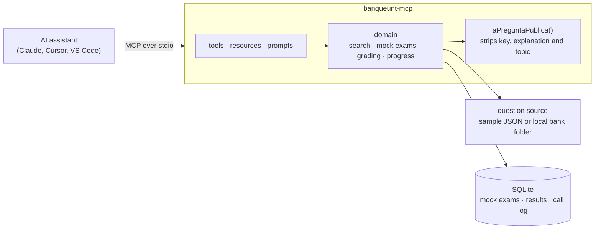

# BanqueUNT MCP

[](https://github.com/zumaetaadriel2/banqueunt-mcp/actions/workflows/ci.yml)


An [MCP](https://modelcontextprotocol.io) server that connects the **BanqueUNT** medical question bank (1,400+ exam questions from the Universidad Nacional de Trujillo, Peru) to AI assistants such as Claude, Cursor and VS Code Copilot.

Students can search questions, take mock exams, get graded with detailed explanations and track their weak topics, all from a chat with their favorite assistant. The server is built so the assistant **cannot see the answer key before grading**, so the practice stays honest.

> The full bank is private. This repository ships with a public sample of 30 questions from past exams, so everything below works out of the box.

## Demo

```text
You:    Give me a 5-question mock exam on Cardiology.
Claude: [generar_simulacro] Mock exam 5e63c63bf544 · med2_unt · 5 questions
        1. A 62-year-old man with dyspnea and orthopnea… A) … B) … C) … D) … E) …
        …
You:    1 C, 2 A, 3 B, 4 D, 5 A
Claude: [corregir_simulacro] Score: 4/5 (80 %)
        ✘ 3. You answered B, key D. Why D: … Why not B: … Remember: …
You:    What should I review?
Claude: [mi_progreso] Weakest topics: Heart failure (40 %), Valvular disease (50 %)…
```

## Features

### Tools

| Tool                 | What it does                                                                                                                |
| -------------------- | --------------------------------------------------------------------------------------------------------------------------- |
| `estadisticas_banco` | Counts questions by course, specialty, year and topic. Duplicates published in several exams count once.                    |
| `buscar_preguntas`   | Full-text search (accent and case insensitive) with filters and cursor pagination. Never returns the answer.                |
| `generar_simulacro`  | Builds a random mock exam (1–100 questions), preferring questions the student has not seen yet. Stored with an expiry time. |
| `corregir_simulacro` | Grades a mock exam once: score, answer key and a normalized explanation for every wrong answer. Records results by topic.   |
| `mi_progreso`        | History, accuracy by specialty and topic, the 5 weakest topics and recently failed topics.                                  |
| `explicar_pregunta`  | Full explanation of a question the student has **already** answered and had graded.                                         |

Every tool declares an input and output schema with zod and returns `structuredContent`; read-only tools are annotated with `readOnlyHint`.

### Resources and prompts

- `banqueunt://cursos`, `banqueunt://cursos/{curso}/temas` (with argument completion) and `banqueunt://pregunta/{id}` (public version, no answer).
- `sesion_de_repaso`: a tutor that asks one question at a time, waits for the answer, grades it and explains.
- `repasar_temas_debiles`: reads your progress and builds a mock exam from your weak topics.

## Quick start

Requires **Node.js 22.13 or later** (it uses the built-in `node:sqlite`).

```bash
git clone https://github.com/zumaetaadriel2/banqueunt-mcp.git
cd banqueunt-mcp
npm ci
npm run build
```

Then add the server to your client. Replace the path with the absolute path to `dist/index.js` on your machine.

### Claude Code

```bash
claude mcp add --scope user banqueunt -- node /absolute/path/to/banqueunt-mcp/dist/index.js
```

### Claude Desktop

Edit `claude_desktop_config.json` (Settings → Developer → Edit Config) and restart the app:

```json
{
  "mcpServers": {
    "banqueunt": {
      "command": "node",
      "args": ["C:\\path\\to\\banqueunt-mcp\\dist\\index.js"]
    }
  }
}
```

### Cursor

Add to `~/.cursor/mcp.json` (global) or `.cursor/mcp.json` (project):

```json
{
  "mcpServers": {
    "banqueunt": {
      "command": "node",
      "args": ["/absolute/path/to/banqueunt-mcp/dist/index.js"]
    }
  }
}
```

### VS Code (GitHub Copilot agent mode)

Add to `.vscode/mcp.json`:

```json
{
  "servers": {
    "banqueunt": {
      "type": "stdio",
      "command": "node",
      "args": ["/absolute/path/to/banqueunt-mcp/dist/index.js"]
    }
  }
}
```

Then ask: _"How many questions are there per specialty?"_ or _"Give me a 10-question mock exam."_

## Configuration

All settings are environment variables, passed through the `env` field of your client config.

| Variable                | Default                                    | Description                                                                      |
| ----------------------- | ------------------------------------------ | -------------------------------------------------------------------------------- |
| `BANQUEUNT_DATA`        | _(unset: bundled sample)_                  | Path to a local bank folder containing `index.json`. File hashes are verified.   |
| `BANQUEUNT_CURSOS`      | `med2_unt`                                 | Enabled courses, comma separated.                                                |
| `BANQUEUNT_DB`          | `%LOCALAPPDATA%\banqueunt-mcp\progreso.db` | SQLite file for mock exams and progress (`~/.local/share/…` on Linux and macOS). |
| `BANQUEUNT_TOPE_DIARIO` | _(unset: no limit)_                        | Maximum questions a user can receive per day (resets at midnight, Peru time).    |

## Architecture



```
src/
  index.ts          stdio entry point
  server.ts         registers tools, resources and prompts
  datos/            zod schema, explanation normalizer, dedup signature, question sources
  dominio/          pure logic: search, mock exams, grading, progress, daily limit
  persistencia/     ProgresoRepo interface + SQLite implementation
  tools/            one file per group of tools
tests/              Vitest: unit tests + end-to-end tests with a real MCP client in memory
```

## Design decisions

- **No answer leaks before grading.** Every pre-grading output goes through a single function, `aPreguntaPublica()`, which removes the key, the explanation and also the _topic_ (a topic such as "Digoxin toxicity" gives the answer away). Integration tests serialize the response of every tool and fail if any of that appears.
- **Two explanation formats, one output.** The bank mixes an old `{correcta, descarte}` format with a richer one (key idea, why each option is wrong, what to remember, reference). Both are validated with a zod union and normalized into a single `Explicacion`.
- **Deduplication.** The same question often appears in several exams. A signature over the normalized stem and sorted options (ported from the original app) keeps counts and mock exams free of repeats.
- **Bank protection.** Searches return at most 20 questions per call, an optional daily cap limits how many questions a user can receive, and every call is logged (`npm run uso`) to spot bulk extraction.
- **Async persistence interface.** `ProgresoRepo` is async so the local SQLite implementation and the planned Cloudflare D1 one share the same contract.

## Development

```bash
npm test            # Vitest (set BANQUEUNT_DATA to also validate the full bank)
npm run lint        # ESLint
npm run typecheck   # tsc --noEmit
npm run inspector   # open MCP Inspector against dist/index.js
npm run uso -- 7    # calls and questions served per user in the last 7 days
```

## Roadmap

- Remote mode for subscribers: Streamable HTTP on Cloudflare Workers, OAuth 2.1 with Supabase Auth login, the bank in a private R2 bucket and progress in D1.
- More courses (ENCIB, Residentado) and images.
- `npx banqueunt-mcp` on npm.

## License

Code under the [MIT License](LICENSE). The bundled sample (`data/muestra.json`) contains questions from past exams for demonstration only; the full BanqueUNT bank is not part of this repository.
